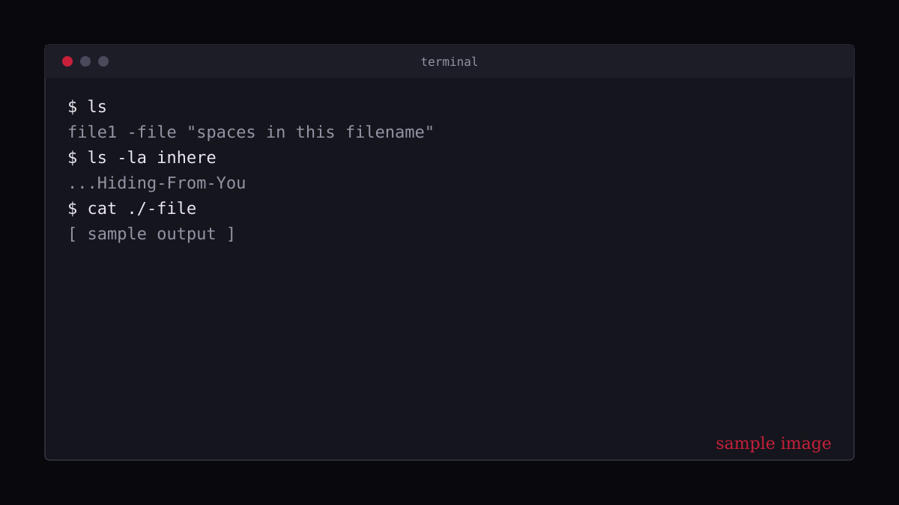

> **Placeholder article.** The structure and commands are real, but replace the story with your own notes.

OverTheWire's **Bandit** wargame teaches you the shell by making it the only way forward. You connect over SSH, find a password hidden somewhere on the machine, and use it to log in to the next level.

I will not post passwords here. They are the point of the exercise, and finding them is where the learning happens. What I can share is the toolkit.

## The connection

Every level starts the same way:

```bash
ssh bandit0@bandit.labs.overthewire.org -p 2220
```

Once you are in, `pwd`, `ls -la` and `cat` get you surprisingly far.

## Files that fight back

Early levels hide files behind awkward names. Dashes, spaces and dotfiles all need different handling.

```bash
cat ./-            # a file literally named "-"
cat "spaces in this filename"
ls -la inhere      # hidden files start with a dot
```



## Searching the filesystem

`find` becomes a daily tool. Filter by size, owner and permissions instead of browsing:

```bash
find / -type f -user bandit7 -group bandit6 -size 33c 2>/dev/null
```

The `2>/dev/null` hides permission errors so real results stand out.

## Text wrangling

Later levels hand you a big file and one clue. The combination to remember is `sort | uniq`:

```bash
sort data.txt | uniq -u    # lines that appear exactly once
strings data.bin | grep '='  # readable text inside a binary
base64 -d encoded.txt      # decode base64
```

## What I took away

- Read the level goal twice. The clue is almost always in the wording.
- Use `man` and `--help` before searching the web.
- Keep notes as you go. My notes became these write-ups.

Next up: encoding, compression and the first levels that involve networking.
